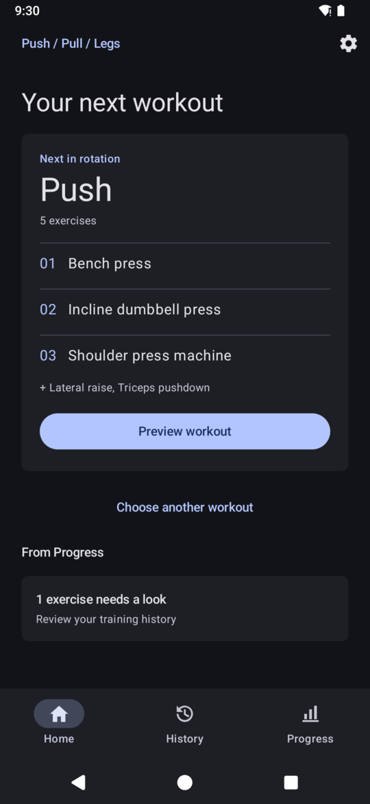
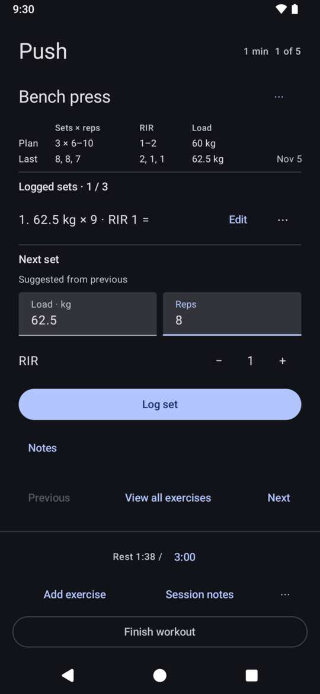
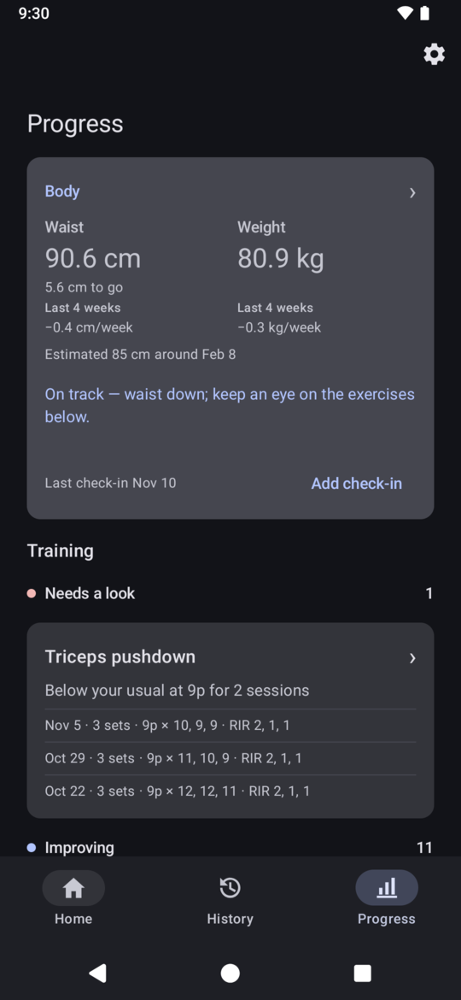
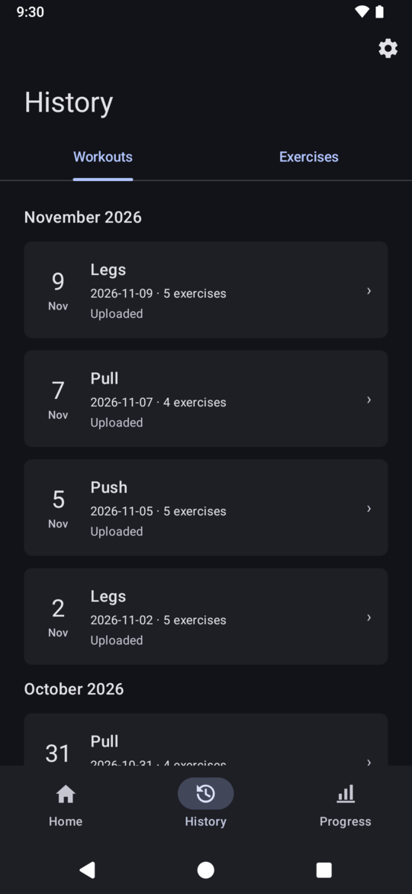

# Repknot

An Android workout logger I built for my own training and use in the gym every day.

I'm analytical by nature and an optimization junkie. I wanted a logger that stays lean but
lets me customize it however I want, so I can track progress precisely and catch a stall
before it costs me weeks. The data lives in a standard Postgres database (Supabase), so a
web dashboard, a CLI, or a coding agent can work with the same records as the phone.

<p>
  
  
  
  
</p>

<sub>Screenshots use a test account with invented data.</sub>

## What it does

- **Today's workout** comes from the active program's rotation. Each exercise shows the
  plan next to what I did last time. Previous numbers are reference only and are never
  logged for me.
- **Logging** is load, reps and RIR per set, with substitutions, notes, a light-day flag,
  and a rest timer driven by the program's rest targets.
- **Offline first.** A workout stays on the phone until I tap Upload. It then goes to
  Supabase whole, with retry and revision checks, so no client silently overwrites
  another's edit.
- **Progress** marks each exercise as improving, holding, or needing a look, flags
  sessions where half or more of the lifts (at least three) dropped at once, and pairs the waist/weight trend with
  strength during a cut.
- **History** covers every recorded workout and exercise, including my earlier training
  log imported from Airtable. Ambiguous values are kept as they were rather than guessed.

## How it's built

Kotlin, Jetpack Compose (dark only, wallpaper-based colors on Android 12+), Room, and
Supabase (Postgres, auth, row-level security).

```
android/app     UI, ViewModels, navigation, wiring
android/domain  pure Kotlin rules: today's workout, prefill, progress, body trends
android/data    Room cache and drafts, Supabase client, sync
supabase/       migrations and pgTAP tests
```

- **Data model** ([ADR 002](docs/decisions/002-training-data-model.md)): exercises,
  immutable program versions, and sessions that snapshot their prescription, so editing
  a program never rewrites history.
- **Sync** ([ADR 001](docs/decisions/001-sync-model.md)): server data is cached on the
  phone, in-progress workouts stay local, finished ones are pushed whole. Revisions
  detect conflicts instead of a general sync framework.
- **Access**: row-level security limits every table to its owner. The app ships only the
  publishable key, and receipt writes go through one owner-scoped function. pgTAP tests
  check that a second user can't read or change the first user's data.
- **Tests**: JVM tests for domain rules and screen text, device tests for Room and every
  schema migration since real data landed, pgTAP for the database.

## How I built it

I built it with AI agents inside a process I set up. I own the product decisions, specs,
design approval and the review bar, and the app gets tested where it's used: on my phone,
in the gym.

- **PRD first.** Before any code, [the PRD](Repknot-PRD.md) fixed the scope, the
  principles ("log reality, not assumptions"), the first milestone's acceptance criteria,
  and what was deliberately deferred. Knowing exactly what we were building kept every
  later decision small.
- **Written architecture and decisions.** [Architecture notes](docs/architecture.md) set
  module boundaries. [ADRs](docs/decisions/) record the choices later work depends on.
- **Rules for agents.** [AGENTS.md](AGENTS.md) covers how to size work, when a task needs
  a written plan, and what every commit must say: what was verified, what wasn't, and
  what needs a careful review. Auth, data-rewriting migrations, sync logic and weakened
  tests are always flagged.
- **Lead and worker.** A lead agent plans, writes task specs and reviews. A second model
  implements well-specified tasks through `scripts/delegate`. The lead re-runs the checks
  and reads the diff. A report alone is never accepted.
- **Empirical verification.** Claims are backed by commands that actually ran: build,
  lint, unit tests, pgTAP against the dev database, device tests, and checks on a real
  phone. Anything unverified is recorded as unverified.
- **Bounded self-improvement.** Every worker miss is classified as a spec gap, a one-off,
  a repeat, or a capability gap. Only repeated failures become a worker rule, capped at
  twelve ([miss log](docs/delegation/README.md#miss-log)).
- **Task records.** [docs/tasks](docs/tasks/) keeps each step's plan, decisions,
  verification and handoff, so any session can resume without chat history.

In hindsight I'd finalize the UI design before building screens. Several were redesigned
after the first days of real use.

## Run it

Requirements: Android SDK platform 36 with build tools 36.0.0 (`ANDROID_HOME` or
`android/local.properties`), and a JDK that runs Gradle (Android Studio's bundled JBR works).

```sh
scripts/check                          # debug build, lint, unit tests
cd android && ./gradlew :app:installDebug
```

The app builds without a backend, but programs and exercises come from Supabase. To use
your own project: copy `.env.example` to `.env`, `supabase link` it, run `scripts/db push`
to apply the migrations, then add exercises and a program with `scripts/repknot`
(`seed-exercises`, `publish-program`). Device tests need a connected phone:
`cd android && ./gradlew :data:connectedDebugAndroidTest`.

Some vendor Android builds block a fresh install's network access. If sign-in fails with
"Unable to resolve host", allow Wi-Fi and mobile data for Repknot in the app settings.

## Not done yet

- A web companion: an analytics dashboard for big screens on the same Supabase data.
- The ChatGPT integration from the PRD isn't verified yet.
- The rest alert doesn't reach a paired smartwatch yet.
- No sample program in the repo, so a new backend starts empty.
- Checks run locally. There is no CI.

## License

[MIT](LICENSE)
